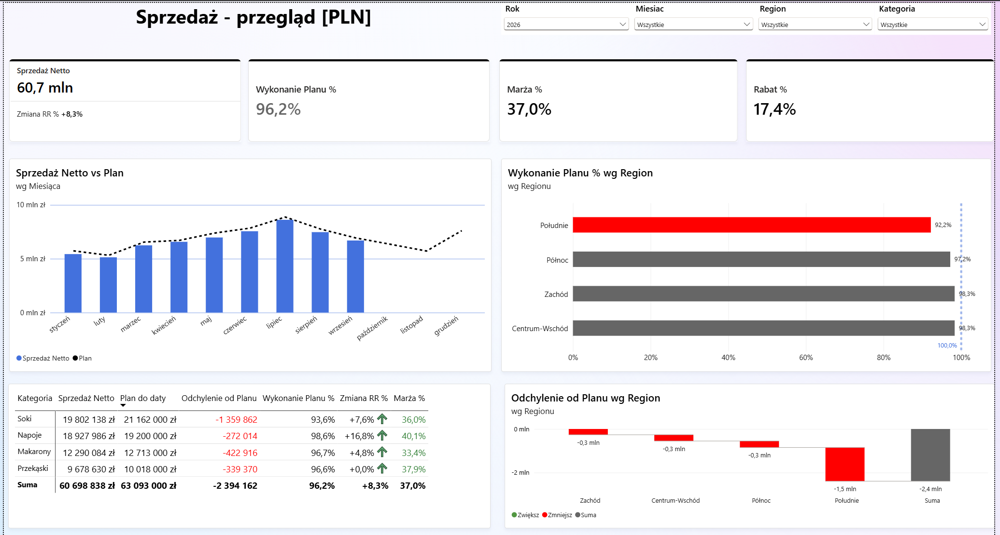
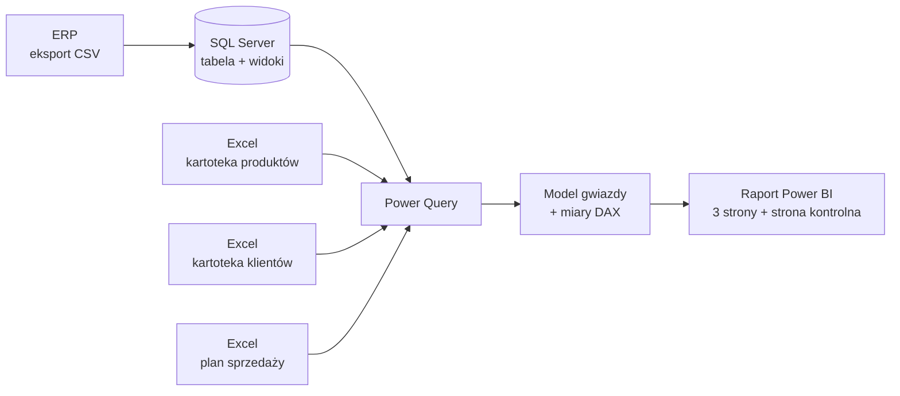
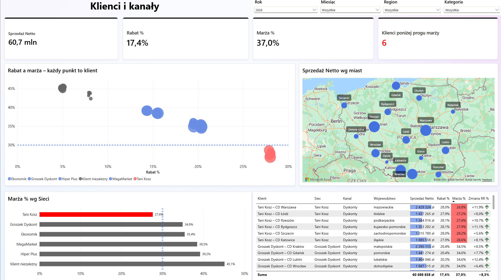
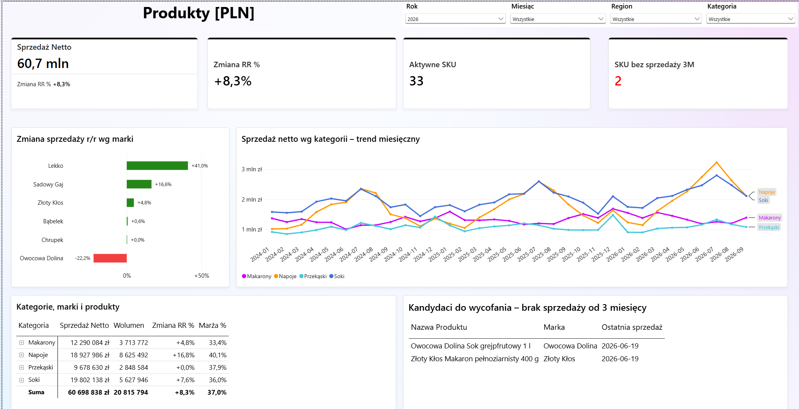

# Raport sprzedaży FMCG w Power BI – projekt end-to-end

Projekt symuluje **migrację raportowania sprzedaży z Excela do Power BI** w fikcyjnej firmie FMCG *Zdrojowa Sp. z o.o.* (soki, napoje, makarony, przekąski). Obejmuje cały proces: od zebrania wymagań biznesowych, przez SQL, Power Query i model gwiazdy, po DAX, raport, kontrolę jakości danych i optymalizację modelu.

> Dane są w pełni syntetyczne, wygenerowane na potrzeby projektu. Firma, klienci i marki są fikcyjne.



## Problem biznesowy

Dyrektor sprzedaży co miesiąc dostawała kilka zestawień w Excelu, przygotowywanych ręcznie przez kontroling (ok. 3 dni pracy), a liczby w nich się nie zgadzały. Cel projektu:

- **jedno źródło prawdy** o sprzedaży,
- odpowiedź na pytania: *czy realizujemy plan i gdzie są odchylenia? które marki rosną, a które spadają? na których klientach rabaty zjadają marżę? które produkty wycofać?*,
- raport gotowy bez ręcznej pracy.

Pełna specyfikacja wymagań: [docs/specyfikacja.md](docs/specyfikacja.md).

## Kluczowe wnioski z analizy

1. **Problemem Południa jest plan, a nie sprzedaż.** Region co roku realizuje tylko 91–92% planu (pozostałe regiony 97–99%), ale rośnie rok do roku w tempie firmy (+8,5% vs +8,3%). Południe odpowiada za ok. 1,5 mln z 2,4 mln zł luki do planu w 2026 r. Rekomendacja: weryfikacja założeń budżetowych przed planowaniem 2027.
2. **Jedna sieć obniża marżę całego kanału dyskontowego.** Tani Kosz dostaje rabat ok. 28% (pozostałe dyskonty ok. 20%) i jako jedyna sieć ma marżę poniżej progu 30%. Różnica w warunkach handlowych to ok. 1 mln zł marży w 9 miesięcy 2026 r. (przy założeniu niezmienionego wolumenu).
3. **Marka Owocowa Dolina wymaga przeglądu portfela.** Sprzedaż spada o 22% r/r, a jeden z jej produktów przestał się sprzedawać w czerwcu 2026 r.
4. **Wzrost marki Lekko (+41% r/r) jest częściowo efektem nowego produktu** wprowadzonego w marcu 2026 r. – porównanie like-for-like daje niższy wynik.

## Architektura



## Model danych

Model gwiazdy z dwiema tabelami faktów o **różnej szczegółowości**:

| Tabela | Typ | Szczegółowość / opis |
|---|---|---|
| FaktSprzedaz | fakt | linia faktury: dzień × klient × SKU (ok. 190 tys. wierszy) |
| FaktPlan | fakt | miesiąc × region × kategoria (576 wierszy) |
| DimData | wymiar | kalendarz 2024–2026 (DAX), oznaczony jako tabela dat |
| DimProdukt | wymiar | 36 SKU, 6 marek, 4 kategorie |
| DimKlient | wymiar | 58 klientów, 4 kanały, 16 województw |
| DimRegion | wymiar | 4 regiony sprzedażowe – wspólny dla sprzedaży i planu |
| DimKategoria | wymiar | 4 kategorie – wspólny dla sprzedaży i planu |

Plan nie ma klienta ani produktu, dlatego region i kategoria są wydzielone do osobnych wymiarów, które filtrują obie tabele faktów. Miara planu zwraca pustą wartość poniżej poziomu, na którym plan istnieje (np. przy filtrze na kanał lub dzień), zamiast pokazywać mylące liczby. Wszystkie relacje są typu jeden-do-wielu z jednokierunkowym filtrowaniem.

## Przebieg projektu

| Etap | Co zostało zrobione |
|---|---|
| Wymagania | Wywiad z „klientem”, specyfikacja KPI, wymiarów i kryteriów akceptacji |
| SQL | Ładowanie CSV (`BULK INSERT`), widoki jako warstwa pośrednia dla Power BI, zapytania eksploracyjne |
| Power Query | Profilowanie danych, czyszczenie kartotek, scalanie ze słownikiem województw, automatyczne łączenie arkuszy planu i *unpivot* |
| Model | Model gwiazdy, tabela dat, rozwiązanie problemu różnej szczegółowości |
| DAX | Marża (iteracja `SUMX` + `RELATED`), wykonanie planu do daty, r/r dla niepełnego roku, przejście kontekstu, miary jakości danych |
| Raport | 3 strony z interakcjami, formatowaniem warunkowym, synchronizacją fragmentatorów i dynamicznymi tytułami |
| Jakość danych | Ukryta strona kontrolna z liczbami do weryfikacji po każdym odświeżeniu |
| Optymalizacja | Analiza w DAX Studio (VertiPaq Analyzer) i Analizatorze wydajności |

### Problemy z jakością danych i sposób ich rozwiązania

| Problem | Rozwiązanie |
|---|---|
| Duplikaty kluczy (SKU, KlientID) | usunięcie w Power Query + reguła usuwania duplikatów jako zabezpieczenie |
| Różny zapis województw, kategorii i marek | przycinanie, ujednolicenie wielkości liter, zamiana wartości; walidacja przez scalenie ze słownikiem (58/58) |
| Ceny zapisane jako tekst z przecinkiem | zmiana typu z ustawieniami regionalnymi (pl-PL) |
| Brakujący koszt i kanał, SKU sprzedawane bez kartoteki | uzupełnienie u źródła przez właściciela danych + miara kontrolna „Sprzedaż bez produktu w kartotece” |
| Plan w formacie „szerokim” z wierszami i kolumnami sum | pominięcie nagłówków, usunięcie sum, *unpivot*, budowa daty z nazwy miesiąca |

### Optymalizacja modelu

| | Przed | Po | Zmiana |
|---|---|---|---|
| Plik .pbix | 3,81 MB | 1,85 MB | −51% |
| Model (VertiPaq) | 4,75 MB | 2,57 MB | −46% |
| Tabela FaktSprzedaz | 4,05 MB | 2,14 MB | −47% |

Zmiany: usunięcie nieużywanych kolumn o wysokiej kardynalności u źródła (widok SQL), zastąpienie przechowywanej sprzedaży netto miarą, typ stałej liczby dziesiętnej dla kwot, wyłączenie automatycznej daty/godziny. Wyniki raportu pozostały identyczne.

Wszystkie miary DAX: [docs/miary_dax.md](docs/miary_dax.md).

## Raport

| Strona | Odpowiada na pytanie |
|---|---|
| Przegląd | Czy realizujemy plan i gdzie są odchylenia? |
| Klienci i kanały | Gdzie rabaty zjadają marżę? |
| Produkty | Które marki rosną, a które spadają? Co wycofać? Jaka jest sezonowość? |
| Kontrola danych (ukryta) | Czy dane po odświeżeniu są kompletne i zgodne ze źródłem? |





## Technologie

Power BI Desktop · DAX · Power Query (M) · SQL Server (T-SQL) · Excel · DAX Studio

## Struktura repozytorium

```
├── dane/                  # dane źródłowe (CSV z ERP, kartoteki i plan w Excelu)
├── sql/
│   ├── 01_utworz_baze.sql # baza, tabela sprzedaży, import CSV, słownik województw
│   └── 02_widoki.sql      # widoki dla Power BI
├── pbix/                  # plik raportu
├── docs/
│   ├── specyfikacja.md    # wymagania biznesowe
│   ├── miary_dax.md       # wszystkie miary DAX z opisem
│   └── img/               # zrzuty ekranu
└── README.md
```

## Jak uruchomić

1. Skopiuj folder `dane` do `C:\Projekty\Zdrojowa_PowerBI\dane`.
2. W SQL Server Management Studio uruchom kolejno `sql/01_utworz_baze.sql` i `sql/02_widoki.sql`.
3. Otwórz plik `.pbix`. Jeśli Twój serwer SQL ma inną nazwę niż `localhost`, zmień ją w Power Query (Narzędzia główne → Przekształć dane → Ustawienia źródła danych).
4. Zmień ścieżki do plików Excel w tym samym miejscu, jeśli folder z danymi jest w innej lokalizacji.

## Ograniczenia i dalsze kroki

- Koszt jednostkowy produktu jest stały w czasie (założenie biznesowe), dlatego trend marży między latami jest zawyżony – w rzeczywistym wdrożeniu potrzebna byłaby historia kosztów.
- Plan istnieje tylko na poziomie region × kategoria × miesiąc; plan na poziomie kanału wymagałby decyzji biznesowej o sposobie alokacji.
- Planowane rozszerzenia: dynamiczne zabezpieczenia na poziomie wierszy (RLS) dla kierowników regionalnych, publikacja w Power BI Service z harmonogramem odświeżania, strona szczegółów klienta (drillthrough).

## Autor

**[Imię Nazwisko]** · [LinkedIn](https://www.linkedin.com/in/twoj-profil)

Projekt zrealizowany w ramach nauki analizy danych (Excel, SQL, Power BI, DAX).
